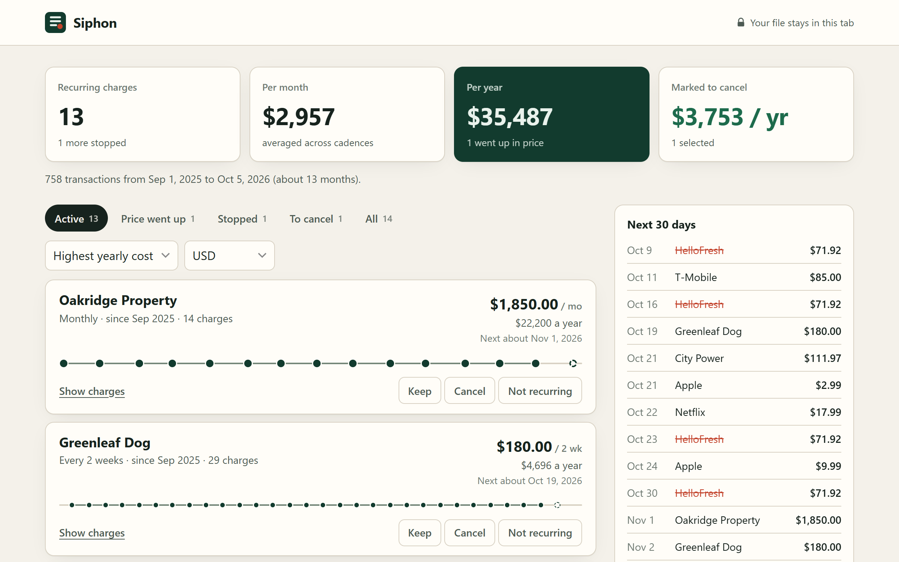

# Siphon

Find every subscription hiding in your bank statement. Drop in a CSV export from your bank or card and Siphon lists every recurring charge: what it costs a year, which prices went up, which ones stopped billing, and when each one renews next. Everything runs in the browser tab. Nothing is uploaded.

**Live:** https://siphon.johanthegoat.xyz



## Why

Most people do not know what they pay for every month. A 2022 C+R Research survey of 1,000 US adults found people guessed $86 a month and actually spent $219, and 42% had forgotten a subscription they were still paying for ([CNBC](https://www.cnbc.com/2022/09/06/consumers-underestimate-monthly-subscription-costs-by-at-least-100.html)). The apps that find them for you, like Rocket Money, ask you to link your bank through an aggregator that then sees your whole transaction history. Manual trackers avoid that, but only know about the subscriptions you already remember.

Your bank already gives you the data as a CSV download. Siphon reads that file locally and does the finding.

## What it does

- **Reads messy bank CSVs.** Sniffs the delimiter (comma, semicolon, tab, pipe), skips preamble lines, finds the date, description and amount columns from headers and content, and handles a single signed amount column or separate money out / money in columns. Amounts like `$1,234.56`, `1.234,56 €`, `(12.00)` and `12.00 DR` all parse. Day-first and month-first dates are told apart from the values, from the file's sort order, and from the dotted `31.12.2026` style. Every column choice can be overridden.
- **Groups charges by merchant.** Strips card numbers, store IDs, reference codes and payment processor prefixes (`SQ *`, `PAYPAL *`, `PADDLE*` and others), and recognises 95 common services by name so `NETFLIX.COM 866-579-7172 CA` and `Netflix` land together.
- **Finds the schedule.** Looks for chains of charges on a weekly, two-weekly, monthly, quarterly, six-monthly or yearly rhythm at a steady price, or a slowly varying one for utilities and meal kits. A recognised service needs two charges; anything else needs three. Shops you visit often are ruled out even when you pay the same price each time.
- **Shows what changed.** Price rises with the date and percentage, subscriptions that stopped billing and how many cycles they missed, and two plans from the same merchant listed separately.
- **Helps you act.** Mark each charge Keep, Cancel or Not recurring (saved in this browser only) and see the yearly total you would save. The next 30 days of expected charges sit in a sidebar.
- **Takes it with you.** Export an `.ics` calendar with a reminder three days before every renewal, or the full list as CSV (formula-looking cells are neutralised so the file is safe to open in a spreadsheet).
- **Merges overlapping downloads.** Drop several months or several accounts at once; transactions that appear in two files are counted once.

## Privacy

The page ships with a Content-Security-Policy of `connect-src 'none'`, so the browser refuses any network request the page tries to make after it loads. There is no server, no account and no analytics. Your Keep and Cancel choices live in `localStorage` on your device.

## Run it

No install and no build step. Open `index.html` in a browser, or serve the folder:

```bash
python -m http.server 5190
```

and open `http://localhost:5190`. The **Try a sample statement** button generates a realistic 13-month checking account so you can see it work without your own data.

## Tests

```bash
npm test
```

17 tests with no dependencies, run by `node:test`, cover the CSV parser, delimiter sniffing, amount and date formats, column mapping for several export layouts, merchant cleaning, price rises, stopped subscriptions, the frequent-shop false positive, merging, the summary maths, the calendar export and formula escaping.

```bash
npm run sweep -- 1000
```

runs the detector over 1,000 seeded synthetic statements, each with 15 planted recurring charges mixed into everyday spending, and reports recall and precision. On the current build it finds all 15,000 planted charges with 20 false positives (precision 99.87%). The generator is written alongside the detector, so this measures consistency on known patterns, not accuracy on every bank in the world.

## Limits

- It needs a CSV. PDF statements are detected and rejected with a hint to look for the CSV option on the bank's download page.
- Yearly renewals need about 13 months of history to appear, and monthly ones need about three.
- A subscription billed through a wallet or app store (for example `APPLE.COM/BILL`) shows up as that store, not the individual app.
- It does not cancel anything for you.

## Layout

```
index.html        page and Content-Security-Policy
style.css         light and dark theme
src/engine.js     parser, column mapping, merchant cleaning, detection, exports (UMD, no DOM)
src/sample.js     seeded sample statement generator
src/app.js        UI
test/             node:test suite
tools/            accuracy sweep and a debug printer
```

## License

MIT, see [LICENSE](LICENSE).
